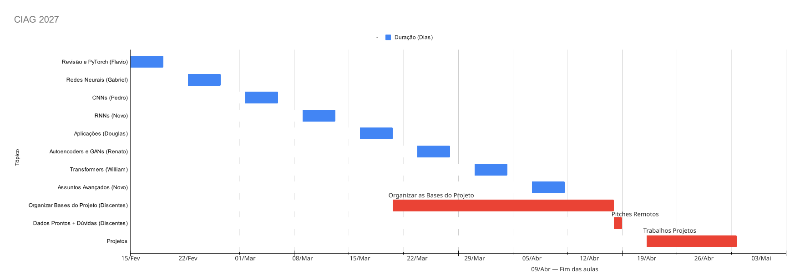

| [🛝🛝 Slides](https://drive.google.com/drive/folders/1EK9_YrhJYX2UvyvZV4pXmVpHRz9pn61s?usp=sharing)  | [⏰ Logística](#logistica) | [📅 Calendário](#calendario) | [🧠 Projeto](#projeto) | [❓ Sobre esse GIT](#material)  | 
|------------------------------------------------------------------------------------------------------|----------------------------|-----------------------------|------------------------|---------------------------------|

# CIAG 2027.1 - Belo Horizonte 

## Aprendizado Profundo

Aprendizado  de  Máquina  compreende  uma  subárea  da  Inteligência  Artificial  na qual  a  modelagem  de  um  problema  e  suas  respectivas regras  e  hipóteses são aprendidas  de  forma  automática  a  partir  dos  dados  disponíveis.  Esse  tipo  de abordagem  tem  ganho  força  em  diversas  áreas  como  biologia,  neurociências, controle  de  tráfego,  indústria  automobilística  e,  mais  recentemente,  geociências. O objetivo do curso aqui descrito é na exploração de sub-área de aprendizado denominada de Aprendizado Profundo (Deep Learning).

**Os slides encontram-se neste [link](https://drive.google.com/drive/folders/1EK9_YrhJYX2UvyvZV4pXmVpHRz9pn61s?usp=sharing) (também indicado acima na tabela de tópicos)**

<a name="logistica"/>

## ⏰ Logística de Aulas 

- Local: UFMG

|  Hora        |  Atividade         |
|--------------|--------------------|
| 8:00-9:00h   | Dúvidas            |
| 9:00-10:15h  | Aula Expositiva    |
| 10:15-10:30h | Break              |
| 10:30-11:45h | Aula Expositiva    |
| 11:45-13:15h | Almoço             |
| 13:15-15:45h | Aula de Código     |
| 15:45-16:00h | Break              |
| 16:00-17:00h | Aula de Exercícios |

<a name="calendario"/>

## 📅 Calendário

# Cronograma de Aulas — 2027

**Início:** 15/02/2027  
**Término:** 09/04/2027

| Data | Dia | Tema |
|---|---|---|
| 15/02/2027 | Segunda | Computação Diferenciável |
| 16/02/2027 | Terça | Regressão Linear em Torch |
| 17/02/2027 | Quarta | Regressão Logística e HingeSVM em Torch |
| 18/02/2027 | Quinta | Validação Cruzada e Outros Modelos de ML |
| 19/02/2027 | Sexta | Revisão |
| 20/02/2027 | Sábado | |
| 21/02/2027 | Domingo | |
| 22/02/2027 | Segunda | Perceptron e Logística |
| 23/02/2027 | Terça | Redes Neurais e Backpropagation |
| 24/02/2027 | Quarta | Regularização |
| 25/02/2027 | Quinta | Otimização |
| 26/02/2027 | Sexta | Revisão |
| 27/02/2027 | Sábado | |
| 28/02/2027 | Domingo | |
| 01/03/2027 | Segunda | RNNs em Séries Temporais |
| 02/03/2027 | Terça | Vanishing Gradiente e GRU+LSTMs em Séries Temporais |
| 03/03/2027 | Quarta | Modelos de Linguagem (Word2Vec / Glove) |
| 04/03/2027 | Quinta | Redes Recorrentes em Tarefas de Texto |
| 05/03/2027 | Sexta | Revisão |
| 06/03/2027 | Sábado | |
| 07/03/2027 | Domingo | |
| 08/03/2027 | Segunda | CNNs: Breve história, intuição, introdução a aplicações |
| 09/03/2027 | Terça | Convolução strided, same, em imagens RGB |
| 10/03/2027 | Quarta | Estudos de caso: LeNet-5, AlexNet, VGG |
| 11/03/2027 | Quinta | Convoluções 1x1, Inception e ResNets |
| 12/03/2027 | Sexta | Comparação das arquiteturas, DCCNNs, ResNet strikes back! |
| 13/03/2027 | Sábado | |
| 14/03/2027 | Domingo | |
| 15/03/2027 | Segunda | Detecção de objetos (YOLO) |
| 16/03/2027 | Terça | Detecção de objetos (R-CNN) |
| 17/03/2027 | Quarta | Segmentação Semântica |
| 18/03/2027 | Quinta | Tarefas de Visão em Problemas de Geociências |
| 19/03/2027 | Sexta | Revisão |
| 20/03/2027 | Sábado | |
| 21/03/2027 | Domingo | |
| 22/03/2027 | Segunda | Autoencoders |
| 23/03/2027 | Terça | Variational Autoencoders |
| 24/03/2027 | Quarta | GANs (1) |
| 25/03/2027 | Quinta | GANs (2) |
| **26/03/2027** | **Sexta** | **FERIADO — Sexta-feira Santa (sem aula; revisão removida)** |
| 27/03/2027 | Sábado | |
| **28/03/2027** | **Domingo** | **Páscoa** |
| 29/03/2027 | Segunda | Mecanismo de Atenção |
| 30/03/2027 | Terça | Transformers (1) |
| 31/03/2027 | Quarta | Transformers (2) |
| 01/04/2027 | Quinta | Vision Transformers |
| 02/04/2027 | Sexta | Revisão |
| 03/04/2027 | Sábado | |
| 04/04/2027 | Domingo | |
| 05/04/2027 | Segunda | Diffusion |
| 06/04/2027 | Terça | RL |
| 07/04/2027 | Quarta | Deep RL |
| 08/04/2027 | Quinta | LLMs 1 |
| 09/04/2027 | Sexta | Multimodal |

<a name="Projeto"/>

## 🧠 Projetos 

Um ponto importante do nosso curso é a realização de um projeto final. A partir da Semana 08 (05/04/2027), não teremos mais atividades de exercícios e código no período da tarde, que será dedicado ao projeto. Antes disso, já começaremos a discutir os temas. Como o curso será remoto, peço que procurem os professores para conversar sobre suas propostas.

- **15/03/2027 a 05/04/2027** — Definição dos temas, com possibilidade de reuniões remotas com os professores em BH.
- **05/04/2027 a 09/04/2027** — Finalização da organização das bases de dados.
- **12/04/2027 e 13/04/2027** — Apresentações das propostas dos projetos (pitches), em formato remoto.
- **19/04/2027 a 30/04/2027** — Desenvolvimento dos projetos.

<a name="material"/>

## ❓ Sobre esse GIT

Este repositório é dividido em várias pastas. Para cada semana do curso, existe tanto os exercícios
teóricos quanto tarefas práticas. Todo o material é disponibilizado em notebooks Jupyter. Além do
mais, os notebook práticos tem versões que executam no [Colab](https://colab.research.google.com/)
quanto versões que executam em ambiente interno da Petrobras (Tatu).
